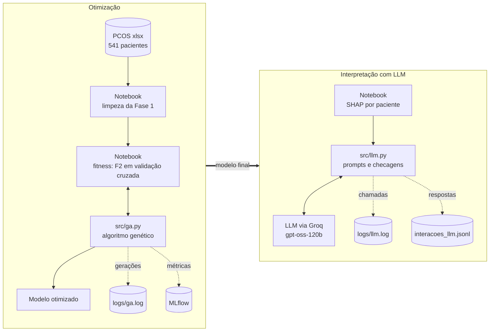

# Arquitetura e decisões técnicas

## 1. Fluxo da solução

Versão em imagem: [`arquitetura.png`](arquitetura.png).

## 2. Componentes

| Componente | Responsabilidade | Depende de |
|---|---|---|
| `notebook/tech_challenge_fase2.ipynb` | carga e limpeza, pipelines, validação cruzada, fitness, experimentos, SHAP, avaliação, gráficos | `src/`, scikit-learn, shap, mlflow |
| `src/ga.py` | espaços de busca, codificação híbrida, operadores genéticos, loop com elitismo e cache, histórico | só numpy |
| `src/llm.py` | cliente único com troca de provedor, novas tentativas e modo offline; prompts v1 a v3; checagens de fidelidade; registro das interações | só a biblioteca padrão (o SDK do provedor é importado sob demanda) |
| `tests/` | testes de propriedades do AG e de prompts, checagens e cliente | pytest |
| `logs/`, MLflow, `outputs/` | rastreamento e resultados | |

## 3. Decisões técnicas

| Decisão | Escolha | Motivo |
|---|---|---|
| Ponto de partida | os três modelos da Fase 1, mesma limpeza e mesma divisão | o enunciado manda comparar com o original; trocar dados misturaria duas mudanças |
| Imputação | `SimpleImputer(median)` dentro do Pipeline | na Fase 1 a mediana usava o dataset inteiro, vazando informação do teste |
| Critério da busca | média do F2 em `StratifiedKFold(5, shuffle=True, random_state=42)` no treino | o teste tem 36 positivos (cada um vale 2,8 pontos de recall); escolher por ele seria otimizar ruído |
| Fitness | F2 (`fbeta_score`, β = 2) | preserva a prioridade de recall da Fase 1 sem premiar o modelo que diz "SOP" para todas (F2 0,708; a mistura 0,7·R + 0,3·F1 daria 0,848, acima do RF e do KNN) |
| Uso do teste | uma única vez, depois da escolha por CV | medida independente da escolha |
| Codificação | híbrida: real, log10, inteiro e categórico, com operadores por tipo | hiperparâmetros têm tipos diferentes no mesmo indivíduo (aula 3 de AG) |
| `C` da Regressão Logística | gene é o expoente, `C = 10 ** gene` | o efeito de C é multiplicativo |
| Penalidade da Regressão Logística | `l1_ratio` em {0, 1} com `liblinear` | `penalty` foi descontinuado no scikit-learn 1.8 |
| Seleção | torneio, k = 3 (roleta implementada e testada) | as fitness ficam entre 0,7 e 0,9; a roleta daria fatias quase iguais |
| Elitismo e cache | 2 indivíduos; cache pelos hiperparâmetros decodificados | o melhor nunca piora; a elite não é treinada de novo |
| AG independente do sklearn | `executar_ag(espaco, avaliar, ...)` | um AG para os três modelos; testes com fitness de brinquedo em milissegundos |
| Experimentos | A base, B população 40, C mutação 0,5; 3 sementes cada | um fator por vez; o AG é estocástico |
| Paralelismo | `n_jobs=-1` só na CV; Random Forest com `n_jobs=1` | paralelizar em dois níveis faz os processos disputarem os mesmos núcleos |
| LLM | `openai/gpt-oss-120b` no Groq, `reasoning_effort="low"` | GPT pré-treinado de pesos abertos com camada gratuita; os LLaMA saíram dos planos gratuito e de desenvolvedor do Groq em 16/08/2026 |
| Troca de provedor | `LLM_PROVIDER` e `LLM_MODEL` no `.env` | a lógica não depende do fornecedor |
| Dados enviados à API | variáveis, valores, probabilidade e SHAP, sem identificador | privacidade (LGPD, dado de saúde é sensível) |
| Prompts | v1 ingênua, v2 papel e regras com temperatura 0, v3 few-shot com JSON | comparar com e sem cada técnica |
| Avaliação do texto | checagens automáticas de fidelidade | não há texto de referência para BLEU; o que importa no contexto clínico é a fidelidade aos dados |
| Rastreamento | `logging` em arquivo + MLflow com SQLite | o armazenamento em pasta do MLflow foi descontinuado |

## 4. Monitoramento

- **`logs/ga.log`**: uma linha por geração (melhor, média, desvio, indivíduos únicos, avaliações, tempo) e o resumo de cada execução.
- **`logs/llm.log`**: uma linha por chamada (provedor, modelo, latência, tokens de entrada e saída, erro) e uma por nova tentativa.
- **MLflow**: uma run por execução do AG, com os parâmetros do algoritmo, as métricas por geração (`step = geração`), os melhores hiperparâmetros e o F2 final. `mlflow ui --backend-store-uri sqlite:///mlflow.db`.
- **`outputs/interacoes_llm.jsonl`**: entrada, versão do prompt, saída, tokens e latência de cada interação; base de dados para o Módulo 3.

**Em produção**, sem rótulo em tempo real, os sinais a monitorar seriam a distribuição das probabilidades previstas e das variáveis de entrada (drift), e, no LLM, latência, consumo de tokens e a taxa de falha das checagens automáticas, que podem rodar em toda resposta.

## 5. Escalabilidade

**Medido localmente** (2 núcleos):

- Paralelismo: as 5 dobras da validação cruzada rodam em processos separados (`n_jobs=-1`).
- Cache: em média 40% dos pedidos de fitness foram atendidos sem treinar nada.
- Os 27 runs levaram cerca de 2,2 h, quase tudo no Random Forest.

**Como escalaria** (documentado, sem deploy, que é opcional no enunciado):

| Parte | Gargalo | Caminho |
|---|---|---|
| AG | avaliações de fitness, independentes dentro de uma geração | distribuir as avaliações de uma geração em um cluster (aula 3 de ML na Cloud); o número de máquinas acompanha o tamanho da população |
| Modelo final | inferência é barata (uma Regressão Logística ou uma floresta pequena) | endpoint gerenciado com autoescala por requisições (aula 2 de ML na Cloud) |
| LLM | limite de taxa e custo por token do provedor | fila com novas tentativas (já implementadas), cache de respostas, e troca de provedor ou LLM on-premises (aula 5 de LLMs) para dado sensível ou volume alto |

## 6. Base para o Módulo 3

1. `montar_prompt(..., contexto_textual=...)` já aceita texto clínico livre (anotações, laudos), hoje vazio.
2. Toda interação fica em `outputs/interacoes_llm.jsonl`, que vira dataset.
3. O cliente LLM é desacoplado do resto: acoplar uma etapa de recuperação (RAG) depois não mexe no AG nem nos modelos.
