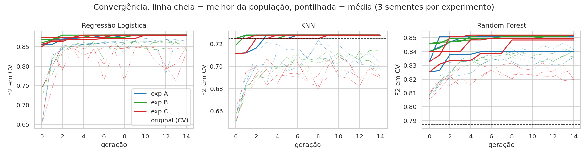

# Relatório Técnico · Tech Challenge Fase 2

**Otimização dos modelos de diagnóstico de SOP com algoritmo genético e interpretação com LLM**

Pós-Graduação IA para Devs (FIAP) · Projeto 1 · Fabricio Geraldo Araujo · novembro de 2026

- Repositório: <https://github.com/fabbaraujo/tech-challenge-fase2>
- Vídeo: <https://youtu.be/h7GsXmkaTb0>

---

## 1. Contexto e objetivo

Na Fase 1 foram treinados três classificadores para apoiar a triagem de Síndrome dos Ovários Policísticos (SOP), com o dataset público `PCOS_data_without_infertility.xlsx` (Kaggle, aba `Full_new`, 541 pacientes, 41 variáveis). A Regressão Logística foi escolhida pelo recall de 0,861 no teste, já que em triagem o pior erro é o falso negativo. Nenhum modelo teve ajuste de hiperparâmetros, e o vídeo da Fase 1 deixou como próximos passos o ajuste de hiperparâmetros, o ajuste do limiar de decisão e o monitoramento.

Este projeto cumpre o primeiro e o último desses passos e acrescenta a interpretação das previsões por LLM:

1. otimizar os hiperparâmetros dos três modelos com um algoritmo genético, em três experimentos;
2. comparar os modelos otimizados com os originais;
3. explicar as previsões do modelo final em linguagem natural para o médico, com três versões de prompt avaliadas;
4. registrar e monitorar a execução.

## 2. Implementação do algoritmo genético e resultados da otimização

### 2.1 Protocolo de avaliação: duas correções antes de otimizar

**Vazamento na imputação.** Na Fase 1, os valores ausentes foram preenchidos com a mediana do dataset inteiro antes da separação treino e teste. Agora o `SimpleImputer(strategy="median")` é o primeiro passo do Pipeline, antes do `StandardScaler`, e só aprende com os dados de treino de cada dobra. Como havia só 4 valores ausentes, os números do modelo original no teste não mudaram; a correção é de protocolo.

**Teste pequeno.** O teste tem 109 pacientes, 36 com SOP: cada paciente vale 2,8 pontos de recall. O AG avalia cada indivíduo pela média de uma validação cruzada estratificada de 5 dobras **no treino** (`StratifiedKFold(5, shuffle=True, random_state=42)`, as mesmas dobras para todos). O teste é usado uma única vez, na comparação final.

### 2.2 Baseline no protocolo novo

| Modelo | F2 (CV) | Recall (CV) | Precisão (CV) |
|---|---|---|---|
| Regressão Logística (Fase 1) | 0,790 | 0,787 | 0,810 |
| Random Forest (Fase 1) | 0,787 | 0,767 | 0,899 |
| KNN, k = 5 (Fase 1) | 0,725 | 0,696 | 0,890 |
| Degenerado: "todas têm SOP" | 0,708 | 1,000 | 0,326 |

### 2.3 Função fitness: F2

A fitness precisa manter a prioridade de recall da Fase 1 sem premiar o modelo que diz "SOP" para todas. Uma mistura linear como `0,7·recall + 0,3·F1` falha: o degenerado tira 0,848, acima do Random Forest (0,784) e do KNN (0,720). O **F2** (`fbeta_score` com β = 2, F2 = 5PR / (4P + R)) pesa o recall quatro vezes mais que a precisão e, por ser média harmônica, cai quando a precisão é baixa: o degenerado fica em 0,708, abaixo dos três modelos.

**Fitness = média do F2 na CV de 5 dobras.** Recall, precisão, F1 e AUC são registrados, mas não guiam a busca. Os scorers usam `zero_division=0`, para que um indivíduo que não prevê nenhum positivo receba nota baixa em vez de gerar aviso.

### 2.4 Codificação

Codificação **híbrida** (aula 3 de AG), com um AG por modelo:

| Modelo | Gene | Tipo | Faixa |
|---|---|---|---|
| Regressão Logística (`liblinear`) | `C` | log10 (o gene é o expoente) | 10⁻³ a 10² |
| | `l1_ratio` | categórico | 0 (L2), 1 (L1) |
| | `class_weight` | categórico | None, balanced |
| Random Forest | `n_estimators` | inteiro | 50 a 500 |
| | `max_depth` | inteiro | 2 a 20 |
| | `min_samples_split` | inteiro | 2 a 20 |
| | `max_features` | real | 0,1 a 1,0 |
| | `class_weight` | categórico | None, balanced |
| KNN | `n_neighbors` | inteiro | 1 a 50 |
| | `weights` | categórico | uniform, distance |
| | `p` | categórico | 1 (Manhattan), 2 (Euclidiana) |

O `C` é codificado pelo expoente porque seu efeito é multiplicativo. A penalidade usa `l1_ratio` porque o parâmetro `penalty` foi descontinuado no scikit-learn 1.8.

### 2.5 Operadores e loop (`src/ga.py`)

| Elemento | Implementação |
|---|---|
| Seleção | torneio com k = 3 (roleta implementada e testada; não usada porque as fitness ficam todas entre 0,7 e 0,9 e a roleta daria fatias quase iguais) |
| Cruzamento (taxa 0,9) | aritmético (`α·p1 + (1-α)·p2`) para genes numéricos, com arredondamento nos inteiros; uniforme para os categóricos |
| Mutação (taxa por gene) | gaussiana com desvio de 10% da faixa e `clip` nos limites para genes numéricos; troca de opção nos categóricos |
| Elitismo | 2 indivíduos passam intactos |
| Cache | pelos hiperparâmetros decodificados; indivíduo repetido não é treinado de novo |
| Histórico | por geração: melhor, média e desvio da fitness, indivíduos únicos, avaliações, tempo |

O AG não importa o scikit-learn: recebe a função `avaliar(params) -> float`. O mesmo código serve aos três modelos, e os testes usam uma fitness de brinquedo com ótimo conhecido.

### 2.6 Os três experimentos

Um fator por vez, 3 sementes por experimento, nos 3 modelos (27 execuções, cerca de 2,2 h em 2 núcleos):

| Experimento | População | Gerações | Mutação | Seleção | Elitismo |
|---|---|---|---|---|---|
| A, base | 20 | 15 | 0,2 | torneio, k = 3 | 2 |
| B, população maior | 40 | 15 | 0,2 | torneio, k = 3 | 2 |
| C, mutação alta | 20 | 15 | 0,5 | torneio, k = 3 | 2 |

**Melhor F2 em CV, média (desvio) das 3 sementes:**

| Modelo | Original | A | B | C |
|---|---|---|---|---|
| Regressão Logística | 0,790 | 0,880 (0,000) | 0,880 (0,000) | 0,880 (0,000) |
| Random Forest | 0,787 | 0,847 (0,006) | 0,852 (0,000) | 0,850 (0,002) |
| KNN | 0,725 | 0,728 (0,000) | 0,728 (0,000) | 0,728 (0,000) |

**Avaliações de fato (média por run):** Regressão Logística A 198, B 408, C 249; Random Forest A 250, B 544, C 269; KNN A 62, B 99, C 79.

**Leitura.**

- **Regressão Logística:** os 9 runs convergiram para o mesmo ponto (L1, `class_weight="balanced"`, C ≈ 0,05), com F2 de 0,880 contra 0,790 do original. Em um espaço de 3 genes, todas as configurações acham a região boa; o experimento B gastou o dobro de avaliações para o mesmo resultado.
- **Random Forest:** explorar mais ajudou. B e C terminaram acima de A e com menos variação entre sementes; o C chegou perto do B com o mesmo orçamento de A. Nas curvas, o A para de melhorar até a geração 5, enquanto B e C seguem achando melhorias por mais gerações. A diferença entre experimentos (cerca de 0,005) é menor que o desvio entre dobras da CV (cerca de 0,04): é uma tendência coerente com a teoria, não uma conclusão estatística.
- **KNN:** todos os runs chegaram a `n_neighbors=6`, `weights="distance"`, `p=2`, empatados com o original. O espaço tem 200 combinações e o AG treinou entre 60 e 100; o limite é o modelo (distância com as 41 variáveis com o mesmo peso), não os hiperparâmetros.
- **Custo da exploração:** a média da população no experimento C fica abaixo da de A e B em todos os modelos (curvas pontilhadas): com mutação de 0,5, muitos filhos caem em regiões piores.
- **Cache:** economizou em média 40% dos treinos (79% no KNN, 28% na Regressão Logística, 12% no Random Forest). Ajuda mais onde a população se repete mais (o KNN tem só 200 combinações possíveis).

## 3. Comparativo entre o modelo original e o otimizado

### 3.1 Hiperparâmetros escolhidos (melhor run de cada modelo, pelo F2 em CV)

| Modelo | Run | F2 em CV | Hiperparâmetros |
|---|---|---|---|
| Regressão Logística | `lr-A-s42` | 0,880 | `C=0.0522`, `l1_ratio=1`, `class_weight='balanced'` |
| Random Forest | `rf-B-s43` | 0,852 | `n_estimators=276`, `max_depth=14`, `min_samples_split=14`, `max_features=0.336`, `class_weight='balanced'` |
| KNN | `knn-A-s42` | 0,728 | `n_neighbors=6`, `weights='distance'`, `p=2` |

### 3.2 No conjunto de teste (usado uma única vez)

| Modelo | Versão | F2 | Recall | Precisão | AUC | Falsos negativos | Falsos positivos |
|---|---|---|---|---|---|---|---|
| Regressão Logística | original | 0,852 | 0,861 | 0,816 | 0,951 | 5 | 7 |
| | otimizado | 0,897 | 0,917 | 0,825 | 0,952 | 3 | 7 |
| Random Forest | original | 0,800 | 0,778 | 0,903 | 0,948 | 8 | 3 |
| | otimizado | 0,847 | 0,833 | 0,909 | 0,946 | 6 | 3 |
| KNN | original | 0,760 | 0,722 | 0,963 | 0,937 | 10 | 1 |
| | otimizado | 0,780 | 0,750 | 0,931 | 0,937 | 9 | 2 |

Os números do original no teste são iguais aos da Fase 1 (a correção da imputação não muda nada com 4 ausentes).

**Na CV** (a comparação mais confiável, 432 pacientes em 5 dobras), a Regressão Logística foi de F2 0,790 ± 0,056 para 0,880 ± 0,031 (recall de 0,787 para 0,922, precisão de 0,810 para 0,752), e o Random Forest de 0,787 ± 0,061 para 0,852 ± 0,040. Os ganhos superam o desvio entre dobras. O KNN ficou empatado (0,725 e 0,728).

**No teste**, a Regressão Logística otimizada reduziu os falsos negativos de 5 para 3 (recall de 0,861 para 0,917) sem aumentar os falsos positivos, e o Random Forest de 8 para 6. O AUC praticamente não mudou: o ganho veio da decisão (pesos de classe), não da ordenação das probabilidades. As diferenças no teste são de 1 a 2 pacientes e não seriam conclusivas sozinhas; o que sustenta a conclusão é a concordância com a CV.

**Modelo final** (maior F2 em CV, critério definido antes de olhar o teste): Regressão Logística com `C=0.0522`, `l1_ratio=1`, `class_weight='balanced'`. É o modelo usado na interpretação com LLM.

## 4. Integração com LLM

### 4.1 Abordagem

A LLM não faz a previsão: ela explica a previsão do modelo final. Para cada paciente, o **SHAP** (o mesmo da Fase 1, agora sobre o modelo otimizado) dá as 5 variáveis que mais empurraram a probabilidade para cima ou para baixo. A LLM recebe a probabilidade, a decisão e esses 5 fatores (nome, descrição em português, valor original e direção) e escreve a explicação. **Nenhum identificador de paciente vai para a API.**

**Modelo:** `openai/gpt-oss-120b` via Groq (camada gratuita), com `reasoning_effort="low"`. É um GPT pré-treinado de pesos abertos; o enunciado aceita "GPT, Falcon, LLaMA, etc.". O plano inicial era LLaMA, mas os modelos LLaMA foram desligados nos planos gratuito e de desenvolvedor do Groq em 16/08/2026, e o gpt-oss é o substituto indicado pelo próprio Groq. O provedor e o modelo vêm de variáveis de ambiente; OpenAI e Gemini estão implementados na mesma interface, e sem chave o cliente funciona em modo offline.

**Amostra:** 20 pacientes do teste (10 com SOP, 10 sem) × 3 versões = 60 chamadas. O teste inteiro com as três versões passaria do limite de 200 mil tokens por dia da camada gratuita.

**Base para o Módulo 3:** o montador de prompt aceita um campo `contexto_textual` (anotações clínicas), hoje vazio, e toda interação fica em `outputs/interacoes_llm.jsonl`.

### 4.2 Prompt engineering

| Versão | Técnicas |
|---|---|
| **v1, ingênua** | só "Explique este resultado." e os dados; sem instrução de sistema; temperatura padrão (1,0) |
| **v2, papel e regras** | papel de assistente de apoio à decisão clínica; regras explícitas: não diagnosticar (linguagem de probabilidade), usar só os dados fornecidos, citar os fatores pelo nome exato, repetir a probabilidade, terminar com a ressalva, até 150 palavras; temperatura 0 |
| **v3, few-shot e JSON** | v2 + dois exemplos completos de entrada e saída (um positivo, um negativo, com valores fictícios) + saída em JSON com os campos `resumo`, `fatores_principais`, `confianca`, `sugestao_investigacao`, `limitacoes`, e o modo JSON da API |

Os prompts completos estão em `src/llm.py` (`SYSTEM_V2`, `EXEMPLOS_V3`, `montar_prompt`).

### 4.3 Avaliação da qualidade das interpretações

Sem texto de referência, o BLEU não se aplica. A avaliação é feita por checagens automáticas de fidelidade aos dados (`llm.checar_resposta`, todas as respostas, texto normalizado em minúsculas e sem acento):

- **fator inventado**: na v3, a lista `fatores_principais` comparada com os 5 fornecidos; na v1 e v2, os nomes das 41 colunas procurados no texto;
- **cobertura**: fração dos 5 fatores que aparece na resposta;
- **probabilidade correta**: toda porcentagem citada bate com a do modelo (±1 ponto);
- **diagnóstico definitivo**: expressões como "tem SOP" ou "diagnóstico confirmado";
- **ressalva**: "não substitui", "avaliação médica" e similares;
- **JSON válido** (v3).

**Resultados** (60 respostas, 20 pacientes × 3 versões, nenhum erro de chamada; `outputs/comparativo_prompts.csv`):

| Métrica | v1, ingênua | v2, papel e regras | v3, few-shot e JSON |
|---|---|---|---|
| Sem fator inventado | 100% | 100% | 100% |
| Cobertura dos 5 fatores | 54% | 84% | **100%** |
| Probabilidade correta | 15% | **100%** | **100%** |
| Afirma diagnóstico definitivo | 60% | **0%** | **0%** |
| Com ressalva | 75% | **100%** | **100%** |
| JSON válido | | | **100%** |
| Tokens de entrada (média) | 271 | 451 | 1.245 |
| Tokens de saída (média) | 1.389 | 253 | 214 |

**Leitura.**

- **Nenhuma versão inventou fator.** Com os dados entregues no prompt, a alucinação de variável não apareceu nem na v1. Os problemas da v1 são de forma e de tom.
- **v1:** respostas longas (cerca de 1.400 tokens, com tabelas e seções), diagnóstico afirmado em 12 das 20 e ressalva faltando em 5. A probabilidade correta de 15% pede cuidado na leitura: a v1 repete a probabilidade certa, mas cita outras porcentagens junto (quase sempre o limiar de 50% e, às vezes, números sem fonte nos dados), e a checagem exige que toda porcentagem citada bata com a do modelo.
- **v2:** papel, regras e temperatura 0 resolveram diagnóstico, probabilidade e ressalva, e cortaram a saída para cerca de 250 tokens. A cobertura ficou em 84% porque a v2 deixou de fora 16 dos 48 fatores que **reduzem** a chance: ela tende a citar só o que sustenta a decisão.
- **v3:** os dois exemplos, um com fatores que aumentam e outro com fatores que reduzem, levaram a cobertura a 100%, e o modo JSON deu saída estruturada em todas as respostas. O custo é o prompt: cerca de 1.250 tokens de entrada, quase 3 vezes os da v2.
- **Custo e latência.** As 60 chamadas somaram cerca de 39 mil tokens de entrada e 37 mil de saída, dentro da camada gratuita (a preço de tabela, US$ 0,15 e 0,60 por milhão, seriam cerca de US$ 0,03). O `logs/llm.log` registra 62 novas tentativas por limite de taxa, todas recuperadas. Por isso a latência (média de 4 a 8 s, com picos de 15 s) reflete mais a fila da camada gratuita do que a versão do prompt, e não foi usada na comparação.

**Escolha:** a v3 é a versão recomendada. Ela foi a única que cobriu todos os fatores, e o JSON permite checar a resposta por código antes de mostrar ao médico.

## 5. Monitoramento e arquitetura

- `logs/ga.log`: uma linha por geração do AG; `logs/llm.log`: uma linha por chamada ao LLM (provedor, modelo, latência, tokens, erro) e por nova tentativa.
- MLflow com backend SQLite: uma run por execução do AG, com métricas por geração e os melhores hiperparâmetros.
- `outputs/`: todas as tabelas, gráficos e interações.

**Eficiência:** a validação cruzada roda as 5 dobras em paralelo (`n_jobs=-1`), e o cache de fitness evitou em média 40% dos treinos. **Escalabilidade documentada** (`docs/arquitetura.md`, sem deploy): avaliações de uma geração distribuídas em cluster, modelo final em endpoint com autoescala, LLM com fila, novas tentativas e opção on-premises.

O diagrama de arquitetura e a tabela completa de decisões estão em `docs/arquitetura.md`.

## 6. Desafios enfrentados e soluções

| Desafio | Solução |
|---|---|
| Vazamento de dados na imputação da Fase 1 | `SimpleImputer` dentro do Pipeline |
| Teste pequeno (36 positivos): melhora de uma paciente parece ganho | decisão pela CV no treino; teste usado uma vez; diferença de até 1 paciente tratada como empate |
| Fitness que premia o modelo degenerado | F2 no lugar de recall ou de mistura linear |
| Avisos de precisão indefinida (modelos que não preveem positivos em uma dobra) | `zero_division=0` nos scorers |
| `penalty` descontinuado no scikit-learn 1.8 | gene `l1_ratio` |
| Custo de tempo do Random Forest | cache de fitness e paralelismo na CV; resultados salvos run a run |
| LLaMA desligado na camada gratuita do Groq | `gpt-oss-120b`, com provedor e modelo configuráveis |
| Limite de 200 mil tokens por dia | amostra estratificada de 20 pacientes; geração retomável a partir do `jsonl` |
| Limite de taxa da API | novas tentativas com espera exponencial, só para erros repetíveis |
| Alucinação da LLM | regras no prompt, temperatura 0, few-shot e checagens automáticas |

## 7. Ética, limitações e próximos passos

**Ética e privacidade.** O modelo e a LLM são ferramentas de apoio; os prompts proíbem afirmar diagnóstico e exigem a ressalva, e isso é verificado em cada resposta. Só vão para a API nomes de variáveis, valores, probabilidade e SHAP, sem identificadores. Mesmo assim, dado de saúde é dado sensível na LGPD e exige base legal e contrato com o fornecedor; para uso real, a alternativa é uma LLM on-premises.

**Limitações.**

- Dataset pequeno (541 pacientes) e de uma única origem: os resultados podem não generalizar para outras populações.
- 3 sementes por experimento é pouco para conclusões estatísticas sobre as configurações do AG.
- Escolher o máximo entre centenas de indivíduos infla um pouco o F2 em CV; por isso o teste ficou isolado.
- A avaliação das interpretações é só automática; não houve avaliação por médicos.
- Em texto livre (v1 e v2), a checagem de fator inventado só reconhece nomes de colunas do dataset.
- A v1 usa temperatura 1,0 e a v2 temperatura 0: a comparação v1 contra v2 mistura o efeito do prompt e o da temperatura.
- A checagem de probabilidade é rígida: qualquer porcentagem diferente da do modelo conta como erro, inclusive a citação do limiar de 50%. Ela mede fidelidade estrita, não se a resposta está errada.
- 20 pacientes por versão: as porcentagens da comparação variam de 5 em 5 pontos.

**Próximos passos.**

- Comparar o AG com uma busca aleatória de mesmo orçamento.
- Incluir o limiar de decisão como gene (o próximo passo que sobrou da Fase 1), reportado separado dos hiperparâmetros.
- Validação externa com dados de outros hospitais.
- Avaliação das explicações por médicos.
- Módulo 3: usar o campo `contexto_textual` com anotações clínicas e uma etapa de recuperação (RAG).
